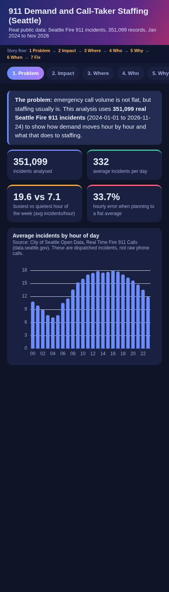

# Seattle 911 Staffing Forecast

Story-driven analysis and staffing model built on real Seattle Fire Department 911 dispatch data: when calls actually arrive, how much a flat weekly schedule overshoots the need, and the hour-by-hour staffing plan that closes the gap.

**Live-style Excel dashboard:** [`Seattle_911_Staffing_Dashboard.xlsx`](./Seattle_911_Staffing_Dashboard.xlsx) - dark, Power BI-style workbook with the full story in 7 tabs (Problem, Impact, Where, Who, Why, When, Fix).

**Interactive HTML dashboard:** [`seattle_dashboard.html`](./seattle_dashboard.html) - download and open in any browser.

## The question

A dispatch center that staffs a flat number of agents every hour of the week pays for calm hours it does not need and still misses its peaks. Using 351,099 real dispatch records (Jan 2024 - Nov 2026), this project quantifies that mismatch and sizes the fix.

## Headline findings

- **Volume:** 331 calls per day on average, ranging 92-662. Medical/aid calls are 75% of all volume (264,048 of 351,099).
- **The shape of demand:** calls peak around 19:00 (~19.6/hr) and bottom out near 04:00 (~7.1/hr) - a 2.8x daily swing that a flat schedule cannot follow.
- **The cost of flat staffing:** a flat 5-agent schedule spends 840 agent-hours/week against a modeled need of 625 - about **25.6% over-staffed overall while still under-covering the evening peak**.
- **Forecast accuracy:** a rolling daily-profile forecast reaches **6.9% WAPE** at the daily level (vs 33.7% for flat and ~25% for a static weekly profile).
- **Where:** the busiest 10% of map cells carry 56.5% of all calls.
- **Spikes:** only 8 days in ~3 years exceeded 130% of normal volume - surges are rare and weather/event-driven, not a staffing baseline.

## Repo layout

| File | What it is |
| --- | --- |
| `Seattle_911_Staffing_Dashboard.xlsx` | The deliverable: 7-tab story dashboard with styled charts |
| `seattle_dashboard.html` | Interactive multi-tab dashboard (same numbers, dark theme) |
| `docs/` | Dashboard screenshots |

## Data

Real public 911 dispatch records from the City of Seattle open data portal (Seattle Real Time Fire 911 Calls), Jan 2024 - Nov 2026, 351,099 incidents after cleaning. See [`DATA.md`](./DATA.md) for source, license and preparation notes.

## Methods in one paragraph

Calls are aggregated to hourly counts by day, weekday, month, incident type and map cell. Staffing need converts hourly call volume into required agent-hours with a service-time assumption and a P90 safety buffer (3-5 agents/hour). Three forecast baselines (flat, static weekly profile, rolling daily profile) are compared on weighted absolute percentage error. No fabricated records: every figure traces to the source file.

## License

Code and documentation: MIT. Data: City of Seattle open data (see DATA.md).
